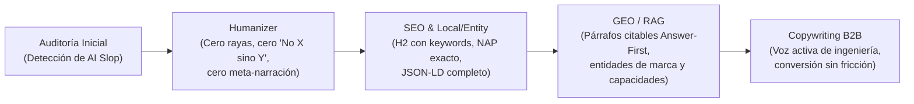

# Informe 3: Informe General Ejecutivo (Humanizer + SEO + GEO + Marketing)

## 1. Resumen Ejecutivo

Se realizó una intervención integral sobre todos los textos, encabezados, tablas y metadatos del sitio web de **COLCRANES S.A.S.**, articulando cuatro disciplinas:
1. **Humanizer (`humanizer`)**: Erradicación total de patrones sintácticos y estructurales propios de modelos de lenguaje (*AI slop*).
2. **SEO Técnico y Semántico (`heading-structure`, `content-optimization`, `entity-seo`, `local-seo`, `eeat-signals`)**: Alineación de encabezados H1–H3, metadatos y `Schema.org` con las búsquedas industriales en Colombia.
3. **GEO / AEO (`generative-engine-optimization`)**: Estructuración de párrafos *Answer-First* y tablas de alta densidad informativa para maximizar citaciones en ChatGPT, Perplexity, Google AI Overviews y Bing Copilot.
4. **Marketing y Copywriting B2B (`copywriting`)**: Enfoque en valor técnico, reducción de riesgo operativo y claridad en la conversión para gerentes de planta, jefes de mantenimiento e ingenieros de proyectos.

---

## 2. Métricas de Limpieza y Optimización

| Indicador de Calidad | Estado Pre-Cambios (Antes) | Estado Post-Cambios (Después) | Impacto |
| :--- | :---: | :---: | :--- |
| **Contrastes negativos artificiales (`§1 Not X but Y`)** | 5 ocurrencias | **0 ocurrencias** | Prosa directa, segura y sin tono defensivo. |
| **Rayas y semirrayas (`§8 Em/En Dashes`)** | 7 ocurrencias | **0 ocurrencias** | Puntuación limpia y natural en español técnico. |
| **Meta-narración sobre el propio sitio/archivo (`§25`)** | 8 ocurrencias | **0 ocurrencias** | El sitio habla 100 % de ingeniería industrial, nunca de cómo se armó la página web. |
| **Lenguaje publicitario inflado / Mayúsculas (`§16, §19`)** | 2 bloques críticos | **0 ocurrencias** | Credibilidad técnica ante compradores B2B. |
| **Encabezados H2 optimizados con Keywords SEO** | 1 de 5 (20 %) | **5 de 5 (100 %)** | Mayor relevancia semántica para *puentes grúa, pórticos, polipastos y mantenimiento en Colombia*. |
| **Propiedades de Entidad y NAP en `Schema.org`** | 6 propiedades básicas | **12 propiedades completas** | Incluye `@id`, `logo`, `streetAddress` de ambas sedes, 3 `contactPoint` y 4 `sameAs`. |

---

## 3. Cómo trabajan juntas las mejoras aplicadas

### A. Voz de Ingeniería Real (Humanizer + E-E-A-T)
Los modelos de IA suelen escribir sobre industria pesada usando frases grandilocuentes (*"las más prestigiosas compañías en el ámbito del manejo de carga del mundo"*) o contrastes retóricos (*"se fabrican en Colcranes, no se revenden"*). Al reemplazar ese *slop* por vocabulario real de taller y montaje (**vigas cajón**, **acero certificado**, **soldadura controlada**, **régimen FEM/ISO**, **alineación topográfica de la vía de rodadura**, **barras blindadas Conductix-Wampfler**), el texto proyecta **Experiencia y Autoridad (E-E-A-T)** inmediata ante un ingeniero o comprador técnico.

### B. Visibilidad en Buscadores Tradicionales y Motores de IA (SEO + GEO)
- **Para Google y Bing (SEO On-Page y Local)**:
  - Los encabezados `H2` ahora responden a búsquedas reales: *"Puentes grúa, pórticos y polipastos"*, *"Ingeniería, montaje y mantenimiento de grúas"*, *"Fabricación propia y montaje en toda Colombia"* y *"Equipos fabricados e instalados en Colombia"*.
  - El bloque JSON-LD en `src/layouts/Layout.astro` vincula de forma inequívoca el nombre legal (**COLCRANES S.A.S.**), las direcciones físicas exactas en **Barranquilla** y **Bogotá**, los teléfonos por área y las redes sociales oficiales (`sameAs`).
- **Para ChatGPT, Perplexity y AI Overviews (GEO / RAG)**:
  - Los motores generativos extraen fragmentos de 40 a 60 palabras que respondan qué hace una empresa, con qué marcas trabaja y qué capacidades maneja.
  - Tanto el subtítulo de `src/components/MachineExplorer.astro` como la tabla de `src/components/Capacity.astro` ahora contienen pares de atributo-valor limpios (por ejemplo, sectores atendidos, sedes, alcance operativo y marcas aliadas: **R&M Materials Handling, World Hoists, DIEPA, AUTEC, Conductix-Wampfler, FELEMAMG**) en lugar de repetir `colcranes.com` como fuente.

### C. Conversión B2B sin Fricción (Marketing)
- En cada punto de contacto (`src/components/Hero.astro`, `src/components/MachineExplorer.astro`, `src/components/Quote.astro`), el usuario entiende exactamente qué ocurre al solicitar una cotización: si ya cuenta con la luz entre rieles, altura bajo gancho y carga nominal, recibe dimensionamiento; si no los tiene, un ingeniero realiza el levantamiento en su planta.

---

## 4. Archivos Intervenidos

1. `src/layouts/Layout.astro` — Title, meta description y Schema.org `Organization` con NAP y `sameAs`.
2. `src/pages/index.astro` — Sincronización de metadatos de portada.
3. `src/components/Header.astro` — Limpieza de raya en `aria-label`.
4. `src/components/Hero.astro` — Limpieza de semirrayas y reemplazo de tríada genérica por señales de producto y ubicación.
5. `src/components/MachineExplorer.astro` — Reescritura completa del bloque de introducción, H2 SEO, fichas técnicas de las 6 familias en voz activa, corrección de numeración (`/ 06`) y nota de cierre.
6. `src/components/Lifecycle.astro` — Nuevo H2 SEO, párrafo *Answer-First* sin contrastes artificiales y precisión técnica en las 7 etapas.
7. `src/components/Capacity.astro` — Eliminación de contrastes negativos, rayas y autorreferencias a `colcranes.com`; enriquecimiento de tabla operativa y capacidades.
8. `src/components/Projects.astro` — H2 activo con localización, eliminación de justificaciones sobre el archivo y las fotos de stock.
9. `src/components/Quote.astro` — Microcopy de conversión directo y positivo.
10. `src/components/Footer.astro` — Descripción corporativa activa alineada con Entity SEO y Local SEO.
